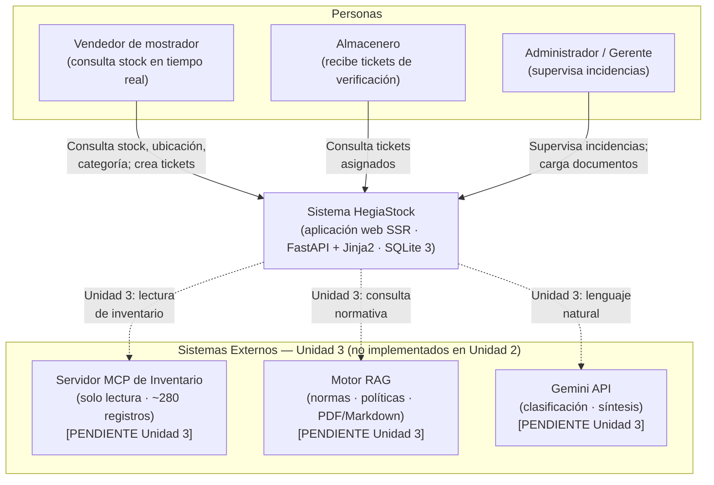
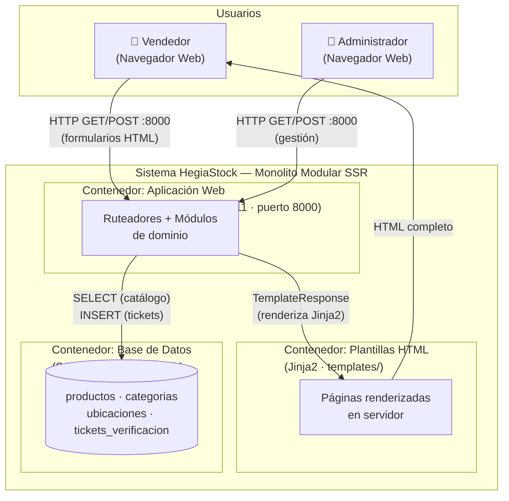
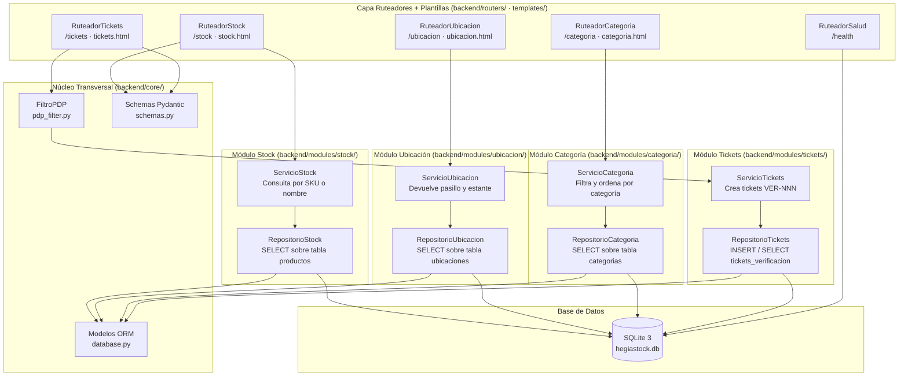
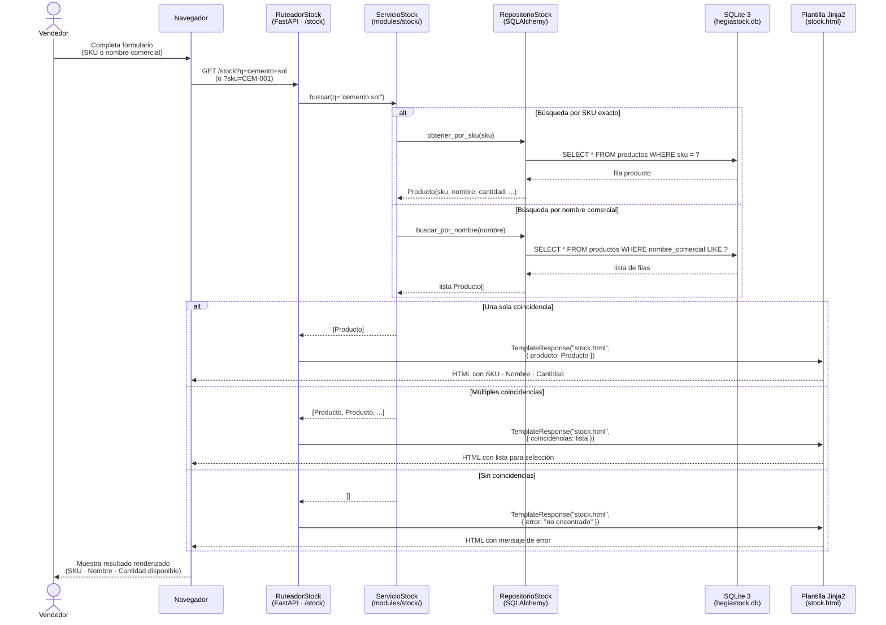
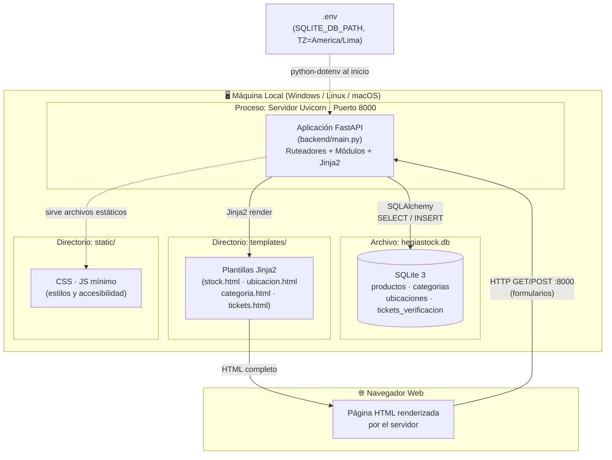

# Documento de Diseño — HegiaStock
**Versión:** 1.0 · **Fecha:** Octubre 2026 · **Estado:** Propuesto

---

## Overview

HegiaStock es una aplicación web de consulta y verificación de inventario para Inversiones Hegiapesa S.A.C. Permite al Vendedor de mostrador consultar stock disponible, ubicación física y categorías de productos, así como registrar solicitudes formales de verificación ante discrepancias. El sistema se construye como un monolito modular con renderizado en servidor (FastAPI + Jinja2), lee el catálogo de productos (cantidad exacta: **PENDIENTE — confirmar con el área de logística de Hegiapesa S.A.C.**) desde SQLite 3 (`hegiastock.db`) y persiste únicamente tickets de verificación en la misma base de datos. No almacena datos personales de clientes (Ley N.° 29733). El punto de extensión para el agente conversacional queda reservado para la Unidad 3 y no se implementa en esta fase.

---

## Architecture

### 2.0 Diagrama C4 Nivel 1 — Contexto del Sistema



> **Nota:** Las conexiones punteadas a sistemas externos son puntos de extensión reservados para la Unidad 3. En la Unidad 2 el catálogo de inventario (≈ PENDIENTE confirmar cantidad exacta de registros — ver Hallazgo C10) se carga directamente en SQLite 3 (`hegiastock.db`).

### 2.1 Diagrama C4 Nivel 2 — Contenedores



### 2.2 Diagrama C4 Nivel 3 — Componentes de la Aplicación



---

## 3. Diagrama de Secuencia — HU01: Consulta de Stock por SKU o Nombre Comercial



---

## 4. Diagrama de Despliegue



---

## Components and Interfaces

### Tabla de Componentes

| Componente | Responsabilidad (una línea) | Carpeta | Historias que satisface |
|---|---|---|---|
| **RuteadorStock** | Recibe peticiones GET/POST a `/stock`, valida parámetros y devuelve `TemplateResponse`. | `backend/routers/stock.py` | HU01 |
| **RuteadorUbicacion** | Recibe peticiones a `/ubicacion` y devuelve la ubicación física renderizada. | `backend/routers/ubicacion.py` | HU02 |
| **RuteadorCategoria** | Recibe peticiones a `/categoria` y devuelve el listado filtrado renderizado. | `backend/routers/categoria.py` | HU03 |
| **RuteadorTickets** | Expone `/tickets` (GET lista y POST creación) con renderizado SSR. | `backend/routers/tickets.py` | HU05 |
| **RuteadorSalud** | Verifica disponibilidad de SQLite y retorna JSON de estado. | `backend/routers/health.py` | Transversal |
| **ServicioStock** | Aplica lógica de búsqueda por SKU exacto o coincidencia de nombre comercial. | `backend/modules/stock/service.py` | HU01 |
| **RepositorioStock** | Ejecuta SELECT sobre la tabla `productos` vía SQLAlchemy. | `backend/modules/stock/repository.py` | HU01 |
| **ServicioUbicacion** | Devuelve pasillo y estante del producto solicitado. | `backend/modules/ubicacion/service.py` | HU02 |
| **RepositorioUbicacion** | Ejecuta SELECT sobre la tabla `ubicaciones` vía SQLAlchemy. | `backend/modules/ubicacion/repository.py` | HU02 |
| **ServicioCategoria** | Filtra productos con stock > 0, limita a 10 y ordena de mayor a menor cantidad. | `backend/modules/categoria/service.py` | HU03 |
| **RepositorioCategoria** | Ejecuta SELECT sobre las tablas `productos` y `categorias` vía SQLAlchemy. | `backend/modules/categoria/repository.py` | HU03 |
| **ServicioTickets** | Crea tickets VER-NNN con correlativo único usando `BEGIN IMMEDIATE`. | `backend/modules/tickets/service.py` | HU05 |
| **RepositorioTickets** | Ejecuta INSERT y SELECT sobre la tabla `tickets_verificacion` vía SQLAlchemy. | `backend/modules/tickets/repository.py` | HU05 |
| **FiltroPDP** | Detecta y enmascara datos personales antes de cualquier persistencia o log. | `backend/core/pdp_filter.py` | HU07 |
| **Schemas Pydantic** | Define y valida los modelos de entrada/salida de los ruteadores. | `backend/core/schemas.py` | Transversal |
| **Modelos ORM** | Declara tablas con SQLAlchemy e inicializa la base de datos; garantiza ausencia de PDP. | `backend/core/database.py` | HU05, HU07 |
| **Plantillas Jinja2** | Renderizan el HTML completo de cada página (stock, ubicación, categoría, tickets). | `templates/` | HU01, HU02, HU03, HU05 |
| **Estilos y Accesibilidad** | Diseño responsivo con fuente ≥ 16 px, contraste WCAG AA y atributos ARIA. | `static/styles.css` | Transversal |

> **Nota C12 — Módulo de Usuarios no implementado en Unidad 2:** el modelo de datos incluye las tablas `rol` y `usuario` (trazadas a HU07). No se declara `RuteadorUsuarios` ni `ServicioUsuarios` en esta tabla porque la decisión de implementar autenticación en Unidad 2 está diferida (ver sección 8, ítem 9 y ADR-004). Si el equipo decide activar login en Unidad 2, deberá agregar los componentes `RuteadorUsuarios`, `ServicioUsuarios` y `RepositorioUsuarios` en `backend/modules/usuarios/` y actualizar esta tabla.

---

## Data Models

### Modelo de Datos

El modelo de datos completo (diagrama ER, tabla de trazabilidad entidad→componente→historia y análisis de protección de datos Ley N.° 29733) se encuentra en:

**[`docs/arquitectura/modelo_datos.md`](../../docs/arquitectura/modelo_datos.md)**

El script DDL para MySQL/MariaDB (XAMPP, entorno de desarrollo) está en:

**[`database/schema.sql`](../../database/schema.sql)**

> **Divergencia de motor documentada:** el DDL de desarrollo usa MySQL/MariaDB (XAMPP); el motor de producción de la Unidad 2 es SQLite 3. Ver ADR-002 sección «Consecuencias — Deuda aceptada».

---

## 5.2 Interfaces y Contratos de Endpoints

Todos los endpoints son SSR (Server-Side Rendering): devuelven `text/html` salvo donde se indica explícitamente `application/json`.

| Método | Ruta | Parámetros de entrada | Respuesta exitosa | Códigos de error | Componente | Historia |
|---|---|---|---|---|---|---|
| `GET` | `/stock` | `q: str` (query — SKU o nombre) · `modo: str` (`sku`\|`nombre`\|`auto`, default `auto`) | `200 HTML` — `stock.html` con producto o lista de coincidencias | `400` parámetro vacío · `404` no encontrado · `503` BD no disponible | RuteadorStock → ServicioStock | HU01 |
| `GET` | `/ubicacion` | `sku: str` (requerido) | `200 HTML` — `ubicacion.html` con pasillo y estante | `400` SKU vacío · `404` sin ubicación registrada · `503` BD | RuteadorUbicacion → ServicioUbicacion | HU02 |
| `GET` | `/categoria` | `nombre: str` (requerido) | `200 HTML` — `categoria.html` con hasta 10 productos con stock > 0, ordenados desc | `400` · `404` categoría inexistente · `204` categoría existe pero sin stock | RuteadorCategoria → ServicioCategoria | HU03 |
| `GET` | `/tickets` | `estado: str` (opcional — `Pendiente`\|`En Verificación`\|`Cerrado`) · `pagina: int` (default 1) | `200 HTML` — `tickets.html` con lista paginada | `400` estado inválido · `503` BD | RuteadorTickets → RepositorioTickets | HU05 |
| `POST` | `/tickets` | Formulario: `sku: str` (requerido) | `303 Redirect → /tickets/{ticket_id}` — ticket VER-NNN creado | `400` SKU inválido · `422` validación Pydantic · `503` BD | RuteadorTickets → ServicioTickets | HU05 |
| `GET` | `/tickets/{ticket_id}` | `ticket_id: str` — formato `VER-NNN` | `200 HTML` — `ticket_detalle.html` | `404` ticket no encontrado · `400` formato inválido | RuteadorTickets → RepositorioTickets | HU05 |
| `GET` | `/health` | — | `200 JSON` — `{"sqlite": "ok", "version": "..."}` | `503 JSON` — `{"sqlite": "error", "detalle": "..."}` | RuteadorSalud | Transversal |

**Contratos de datos (Schemas Pydantic — `backend/core/schemas.py`):**

| Schema | Campos | Validaciones clave |
|---|---|---|
| `ConsultaStockRequest` | `q: str`, `modo: Literal["sku","nombre","auto"]` | `q` min 1 car., max 100 car. |
| `ProductoDetalle` | `sku`, `nombre_comercial`, `nombre_categoria`, `cantidad_disponible: int`, `unidad`, `pasillo: int \| None`, `estante: str \| None` | `cantidad_disponible ≥ 0` |
| `CrearTicketRequest` | `sku: str` | min 1 car., max 50 car.; sin campos de PDP |
| `TicketResponse` | `ticket_id: str`, `sku`, `estado`, `creado_en: datetime` | `ticket_id` regex `^VER-\d{3,}$` |

> **Punto de extensión Unidad 3:** el endpoint `POST /consulta` (o equivalente en `/stock`) aceptará adicionalmente `Content-Type: application/json` cuando el agente conversacional lo invoque. Los módulos de dominio no cambian; solo el ruteador añade un discriminador de tipo de contenido.

En la Unidad 3 se conectará un agente conversacional al sistema. Esta sección reserva el lugar de esa conexión sin diseñarla ni implementarla.

El punto de extensión previsto es la ruta `POST /consulta` (o equivalente) del `RuteadorStock`. En la Unidad 2 esa ruta recibe parámetros de formulario HTML estándar. En la Unidad 3, el agente futuro podrá invocar el mismo endpoint enviando un cuerpo JSON estructurado; los módulos de dominio (`ServicioStock`, `ServicioUbicacion`, `ServicioTickets`) permanecerán sin cambios porque la lógica de negocio ya está desacoplada de la capa de presentación.

Lo que **no** se define aquí: el protocolo del agente, su arquitectura interna, la estrategia de memoria conversacional, la integración con modelos de lenguaje, el uso de MCP ni ningún componente de IA.

---

## 8. Decisiones No Tomadas

Las siguientes decisiones quedan diferidas al diseño detallado o a fases posteriores:

1. **Estrategia de autenticación y autorización.** No se define mecanismo de login, tokens JWT ni separación de roles (Vendedor / Almacenero / Administrador) a nivel de ruteador. Queda para el diseño detallado determinar si se usará autenticación básica HTTP, sesiones con cookie firmada u OAuth 2.0. Ver ADR-004.

2. **Gestión de versiones del esquema SQLite.** Se usa `init_db()` para crear tablas; no se define una estrategia de migraciones (Alembic u otro) para cambios futuros al esquema sin pérdida de datos.

3. **Política de retención y rotación de `audit_log`.** No se especifica cuánto tiempo se conservan los registros de auditoría ni si existe un proceso de purga periódica.

4. **Concurrencia de escritura en SQLite.** Se acepta `BEGIN IMMEDIATE` para tickets, pero no se define qué sucede si el volumen de tickets supera el umbral de bloqueo antes de la Semana 7 (ver criterio de reversión ADR-002).

5. **Formato y destino del `audit_log`.** Se declara la tabla en el ORM pero no se especifica qué eventos exactos se registran, con qué granularidad ni si el log se exporta a un sistema externo.

6. **Configuración de CORS y cabeceras de seguridad HTTP.** No se define la política de `Content-Security-Policy` ni otras cabeceras de endurecimiento para el servidor Uvicorn.

7. **Estrategia de despliegue en cuenta gratuita (Semanas 7–8).** ADR-001 menciona un entorno de despliegue gratuito, pero no se ha seleccionado plataforma ni se han definido variables de entorno para ese entorno.

8. **Internacionalización y zona horaria en la interfaz.** La fecha/hora de tickets usa `America/Lima (UTC-5)` en el backend; no se define cómo se presenta al usuario ni si el frontend adapta el formato según configuración regional.

9. **Módulo de Usuarios / Autenticación en Unidad 2.** El modelo de datos incluye tablas `rol` y `usuario`, pero ningún ruteador ni servicio de autenticación está declarado en design.md para la Unidad 2. El equipo debe decidir: (a) implementar login básico en Unidad 2, o (b) diferirlo a Unidad 3 y acceder al sistema sin autenticación en desarrollo. Esta decisión debe formalizarse en ADR-004.

---

## Correctness Properties

Las siguientes propiedades deben mantenerse invariantes en toda la aplicación durante la Unidad 2:

1. **Sin datos personales de clientes (Ley N.° 29733):** ninguna tabla de la base de datos, ningún log de auditoría y ninguna respuesta HTTP contienen DNI, nombre completo, teléfono, dirección ni datos de pago de clientes finales. Verificado por `FiltroPDP` antes de cada `INSERT` en `ticket_verificacion` y `audit_log`.

2. **Unicidad del correlativo VER-NNN:** el campo `numero_correlativo` de la tabla `ticket_verificacion` tiene restricción `UNIQUE`. `ServicioTickets` usa `BEGIN IMMEDIATE` para obtener `MAX(numero_correlativo) + 1` de forma atómica; no puede existir dos tickets con el mismo correlativo.

3. **Solo lectura del catálogo en Unidad 2:** los repositorios `RepositorioStock`, `RepositorioUbicacion` y `RepositorioCategoria` emiten únicamente sentencias `SELECT`. Ninguna ruta de catálogo expone un endpoint `POST`/`PUT`/`DELETE`.

4. **Stock no negativo:** la columna `cantidad_disponible` tiene `CHECK (cantidad_disponible >= 0)` en el DDL. `ServicioCategoria` filtra adicionalmente `cantidad_disponible > 0` antes de mostrar resultados.

5. **Formato de ticket válido:** todo `ticket_id` devuelto por `ServicioTickets` debe coincidir con la expresión regular `^VER-\d{3,}$`. Validado por el schema Pydantic `TicketResponse`.

6. **Respuesta en tiempo acotado:** `RuteadorSalud` (`GET /health`) verifica que SQLite responda antes de devolver `200 OK`. Si la base de datos no está disponible, todos los endpoints devuelven `503` con mensaje legible en lugar de una excepción sin manejar.

---

## Error Handling

Estrategia de manejo de errores por capa:

| Capa | Situación | Comportamiento esperado | Código HTTP |
|---|---|---|---|
| **RuteadorStock** | `q` vacío o ausente | Redirige al formulario con mensaje de validación | `400` |
| **RuteadorStock** | Producto no encontrado | Renderiza `stock.html` con bloque `` | `404` |
| **RuteadorUbicacion** | SKU sin ubicación asignada | Renderiza `ubicacion.html` con aviso "sin ubicación registrada" | `404` |
| **RuteadorCategoria** | Categoría inexistente | Renderiza `categoria.html` con aviso "categoría no encontrada" | `404` |
| **RuteadorCategoria** | Categoría existe pero sin stock | Renderiza `categoria.html` con aviso "sin existencias disponibles" | `200` |
| **RuteadorTickets POST** | SKU inválido (no en catálogo) | Renderiza formulario con mensaje de error; no crea ticket | `400` |
| **RuteadorTickets POST** | Fallo de escritura en SQLite | Renderiza formulario con aviso "no se pudo registrar; reintente" | `503` |
| **Cualquier ruteador** | SQLite no disponible | Renderiza página de error genérica con aviso y botón de reintento | `503` |
| **Validación Pydantic** | Parámetro fuera de rango o tipo incorrecto | FastAPI devuelve respuesta de error de validación automática | `422` |
| **FiltroPDP** | Campo inesperado con patrón PDP detectado | Lanza `PDPViolationError`; la operación se cancela; evento queda en `audit_log` sanitizado | — |

**Principios generales:**
- Ninguna excepción interna (traceback de Python) llega al navegador del Vendedor. FastAPI registra el error internamente y devuelve una plantilla de error amigable.
- Los mensajes de error visibles al Vendedor no exponen rutas internas, versiones de librerías ni consultas SQL.
- Todos los eventos de error se registran en `audit_log` con `FiltroPDP.sanitizar_para_log()` aplicado al detalle.

---

## Testing Strategy

Niveles de prueba para la Unidad 2:

### Pruebas unitarias (`backend/tests/unit/`)
- **RepositorioStock / ServicioStock:** consulta por SKU exacto, búsqueda LIKE por nombre, resultado vacío, múltiples coincidencias. Base de datos SQLite en memoria (`":memory:"`).
- **RepositorioUbicacion / ServicioUbicacion:** producto con ubicación, producto sin ubicación, formato «Pasillo N, Estante X».
- **RepositorioCategoria / ServicioCategoria:** filtro `stock > 0`, orden descendente, límite 10, categoría vacía, categoría inexistente.
- **ServicioTickets / RepositorioTickets:** creación exitosa (formato `VER-001`), SKU inválido rechazado, fallo de BD propagado, correlativo único bajo llamadas concurrentes (`asyncio.gather`).
- **FiltroPDP:** `sanitizar_para_log` detecta DNI, RUC, teléfono, email y tarjeta; `validar_ticket_sin_pdp` acepta solo las claves permitidas.

### Pruebas de integración (`backend/tests/integration/`)
- Flujo completo `GET /stock?q=...` → respuesta HTML con datos reales de `hegiastock.db` (requiere `database/seed.sql` — **PENDIENTE del equipo**).
- Flujo completo `POST /tickets` → redirección `303` → `GET /tickets/{id}` → ticket en estado Pendiente.
- `GET /health` → `200 JSON {"sqlite": "ok"}` con base de datos activa; `503` con base de datos renombrada.

### Ejecución
```bash
# Unitarias (sin servidor ni red):
pytest backend/tests/unit/ -v --tb=short

# Integración (requiere hegiastock.db poblada):
pytest backend/tests/integration/ -v --tb=short -m integration
```

### Lo que no se prueba en Unidad 2
- Rendimiento bajo carga (p95 ≤ 3 s contra MCP): diferido a Unidad 3 (ver tasks.md sección [UNIDAD 3]).
- Motor RAG y Gemini API: diferidos a Unidad 3.
- Pruebas de propiedad con Hypothesis: opcionales; ver tareas marcadas `*` en tasks.md.

---

## Historial de cambios

| Fecha | Hallazgo auditoría | Cambio realizado |
|---|---|---|
| 2026-10-02 | C1 — Faltaba C4 Nivel 1 | Agregada sección 2.0 con diagrama de Contexto del Sistema en Mermaid |
| 2026-10-02 | C2 — Faltaba sección de interfaces/contratos | Agregada sección 5.2 con tabla de endpoints y contratos Pydantic |
| 2026-10-02 | C3 — Modelo de datos sin enlace formal | Agregada sección 5.1 con referencias a `modelo_datos.md` y `schema.sql` |
| 2026-10-02 | C4 — Vestigios conversacionales en sección 7 | Eliminados ítems sobre `session_id`, `ChatRequest`, orquestador y ChromaDB; sección renumerada como 8 |
| 2026-10-02 | C10 — Cifra "~280 productos" sin fuente | Reemplazada por marca PENDIENTE con instrucción de verificación |
| 2026-10-02 | C12 — `RepositorioUsuarios` en modelo sin componente en design | Agregada nota explicativa al pie de la tabla de componentes |
| 2026-10-02 | Validador Kiro — 7 secciones faltantes | Renombradas secciones al inglés requerido (Overview, Architecture, Components and Interfaces, Data Models); agregadas secciones Correctness Properties, Error Handling y Testing Strategy |
