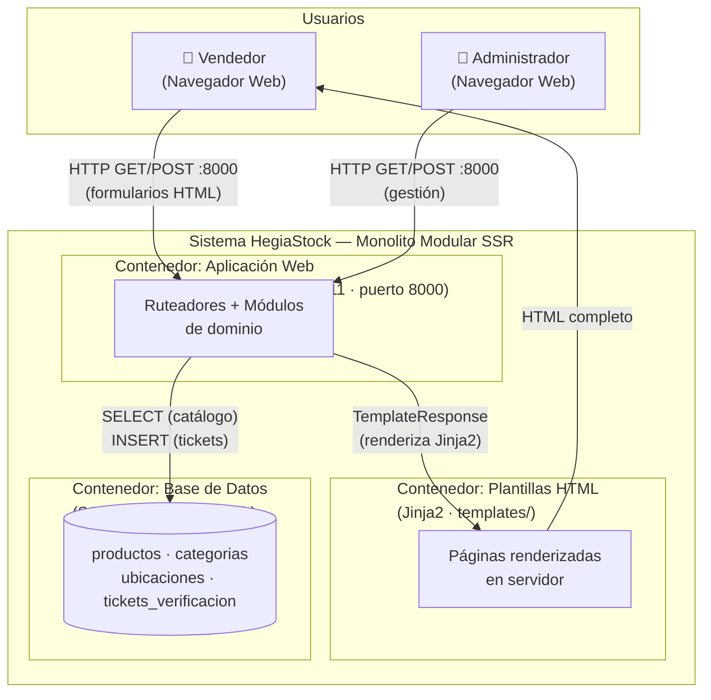
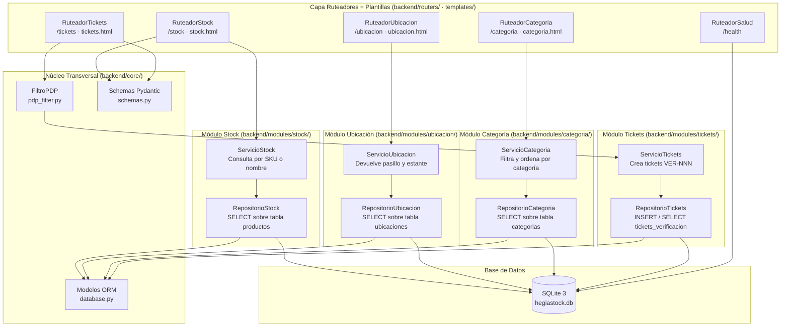
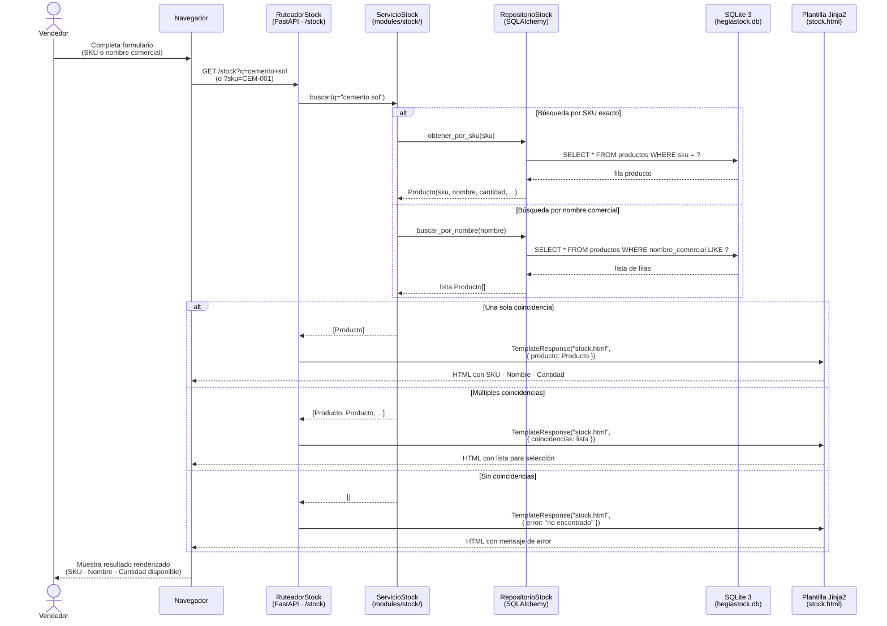
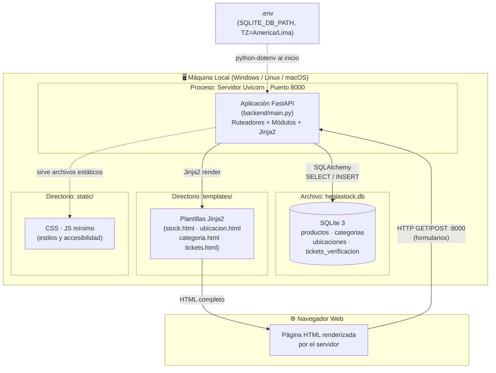

# Documento de Diseño — HegiaStock
**Versión:** 1.0 · **Fecha:** Octubre 2026 · **Estado:** Propuesto

---

## 1. Visión General

HegiaStock es una aplicación web de consulta y verificación de inventario para Inversiones Hegiapesa S.A.C. Permite al Vendedor de mostrador consultar stock disponible, ubicación física y categorías de productos, así como registrar solicitudes formales de verificación ante discrepancias. El sistema se construye como un monolito modular con renderizado en servidor (FastAPI + Jinja2), lee el catálogo de ~280 productos desde SQLite 3 (`hegiastock.db`) y persiste únicamente tickets de verificación en la misma base de datos. No almacena datos personales de clientes (Ley N.° 29733). El punto de extensión para el agente conversacional queda reservado para la Unidad 3 y no se implementa en esta fase.

---

## 2. Diagramas de Arquitectura

### 2.1 Diagrama C4 Nivel 2 — Contenedores

### 2.2 Diagrama C4 Nivel 3 — Componentes de la Aplicación

---

## 3. Diagrama de Secuencia — HU01: Consulta de Stock por SKU o Nombre Comercial

---

## 4. Diagrama de Despliegue

---

## 5. Tabla de Componentes

| Componente | Responsabilidad (una línea) | Carpeta | Historias que satisface |
|---|---|---|---|
| **RuteadorStock** | Recibe peticiones GET/POST a `/stock`, valida parámetros y devuelve `TemplateResponse`. | `backend/routers/stock.py` | HU01 |
| **RuteadorUbicacion** | Recibe peticiones a `/ubicacion` y devuelve la ubicación física renderizada. | `backend/routers/ubicacion.py` | HU02 |
| **RuteadorCategoria** | Recibe peticiones a `/categoria` y devuelve el listado filtrado renderizado. | `backend/routers/categoria.py` | HU03 |
| **RuteadorTickets** | Expone `/tickets` (GET lista y POST creación) con renderizado SSR. | `backend/routers/tickets.py` | HU05 |
| **RuteadorSalud** | Verifica disponibilidad de SQLite y retorna JSON de estado. | `backend/routers/health.py` | Transversal |
| **ServicioStock** | Aplica lógica de búsqueda por SKU exacto o coincidencia de nombre comercial. | `backend/modules/stock/service.py` | HU01 |
| **RepositorioStock** | Ejecuta SELECT sobre la tabla `productos` vía SQLAlchemy. | `backend/modules/stock/repository.py` | HU01 |
| **ServicioUbicacion** | Devuelve pasillo y estante del producto solicitado. | `backend/modules/ubicacion/service.py` | HU02 |
| **RepositorioUbicacion** | Ejecuta SELECT sobre la tabla `ubicaciones` vía SQLAlchemy. | `backend/modules/ubicacion/repository.py` | HU02 |
| **ServicioCategoria** | Filtra productos con stock > 0, limita a 10 y ordena de mayor a menor cantidad. | `backend/modules/categoria/service.py` | HU03 |
| **RepositorioCategoria** | Ejecuta SELECT sobre las tablas `productos` y `categorias` vía SQLAlchemy. | `backend/modules/categoria/repository.py` | HU03 |
| **ServicioTickets** | Crea tickets VER-NNN con correlativo único usando `BEGIN IMMEDIATE`. | `backend/modules/tickets/service.py` | HU05 |
| **RepositorioTickets** | Ejecuta INSERT y SELECT sobre la tabla `tickets_verificacion` vía SQLAlchemy. | `backend/modules/tickets/repository.py` | HU05 |
| **FiltroPDP** | Detecta y enmascara datos personales antes de cualquier persistencia o log. | `backend/core/pdp_filter.py` | HU07 |
| **Schemas Pydantic** | Define y valida los modelos de entrada/salida de los ruteadores. | `backend/core/schemas.py` | Transversal |
| **Modelos ORM** | Declara tablas con SQLAlchemy e inicializa la base de datos; garantiza ausencia de PDP. | `backend/core/database.py` | HU05, HU07 |
| **Plantillas Jinja2** | Renderizan el HTML completo de cada página (stock, ubicación, categoría, tickets). | `templates/` | HU01, HU02, HU03, HU05 |
| **Estilos y Accesibilidad** | Diseño responsivo con fuente ≥ 16 px, contraste WCAG AA y atributos ARIA. | `static/styles.css` | Transversal |

---

## 6. Punto de Extensión para la Unidad 3

En la Unidad 3 se conectará un agente conversacional al sistema. Esta sección reserva el lugar de esa conexión sin diseñarla ni implementarla.

El punto de extensión previsto es la ruta `POST /consulta` (o equivalente) del `RuteadorStock`. En la Unidad 2 esa ruta recibe parámetros de formulario HTML estándar. En la Unidad 3, el agente futuro podrá invocar el mismo endpoint enviando un cuerpo JSON estructurado; los módulos de dominio (`ServicioStock`, `ServicioUbicacion`, `ServicioTickets`) permanecerán sin cambios porque la lógica de negocio ya está desacoplada de la capa de presentación.

Lo que **no** se define aquí: el protocolo del agente, su arquitectura interna, la estrategia de memoria conversacional, la integración con modelos de lenguaje, el uso de MCP ni ningún componente de IA.

---

## 7. Decisiones No Tomadas

Las siguientes decisiones quedan diferidas al diseño detallado o a fases posteriores:

1. **Modelo de sesión en memoria vs. Redis.** El orquestador mantiene el historial por `session_id` en un diccionario en proceso. No se ha decidido si se usará Redis u otro mecanismo de persistencia de sesiones para soportar reinicios del servidor sin pérdida de contexto.

2. **Estrategia de autenticación y autorización.** No se define mecanismo de login, tokens JWT ni separación de roles (Vendedor / Almacenero / Administrador) a nivel de API. Queda para el diseño detallado determinar si se usará autenticación básica, OAuth 2.0 u otro esquema.

3. **Gestión de versiones del esquema SQLite.** Se usa `init_db()` para crear tablas; no se define una estrategia de migraciones (Alembic u otro) para cambios futuros al esquema sin pérdida de datos.

4. **Política de retención y rotación de `audit_log`.** No se especifica cuánto tiempo se conservan los registros de auditoría ni si existe un proceso de purga periódica.

5. **Concurrencia de escritura en SQLite.** Se acepta `BEGIN IMMEDIATE` para tickets, pero no se define qué sucede si el volumen de tickets supera el umbral de bloqueo antes de la Semana 7 (ver criterio de reversión ADR-002).

6. **Modelo de embedding seleccionado para ChromaDB.** Las tareas citan `text-embedding-004` de Google, pero no se fija versión ni se define política de re-indexación cuando el modelo cambie.

7. **Formato y destino del `audit_log`.** Se declara la tabla en el ORM pero no se especifica qué eventos exactos se registran, con qué granularidad ni si el log se exporta a un sistema externo.

8. **Configuración de CORS y cabeceras de seguridad HTTP.** No se define la política de `Access-Control-Allow-Origin`, `Content-Security-Policy` ni otras cabeceras de endurecimiento para el servidor Uvicorn.

9. **Estrategia de despliegue en cuenta gratuita (Semanas 7–8).** ADR-001 menciona un entorno de despliegue gratuito, pero no se ha seleccionado plataforma ni se han definido variables de entorno para ese entorno.

10. **Internacionalización y zona horaria en la interfaz.** La fecha/hora de tickets usa `America/Lima (UTC-5)` en el backend; no se define cómo se presenta al usuario ni si el frontend adapta el formato según configuración regional.