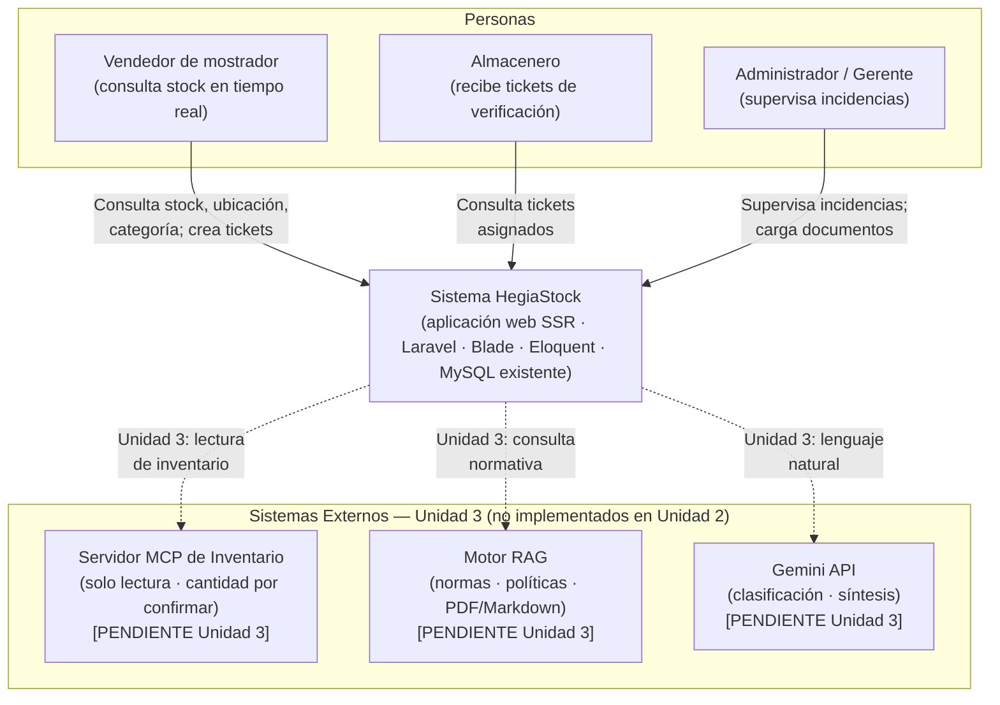
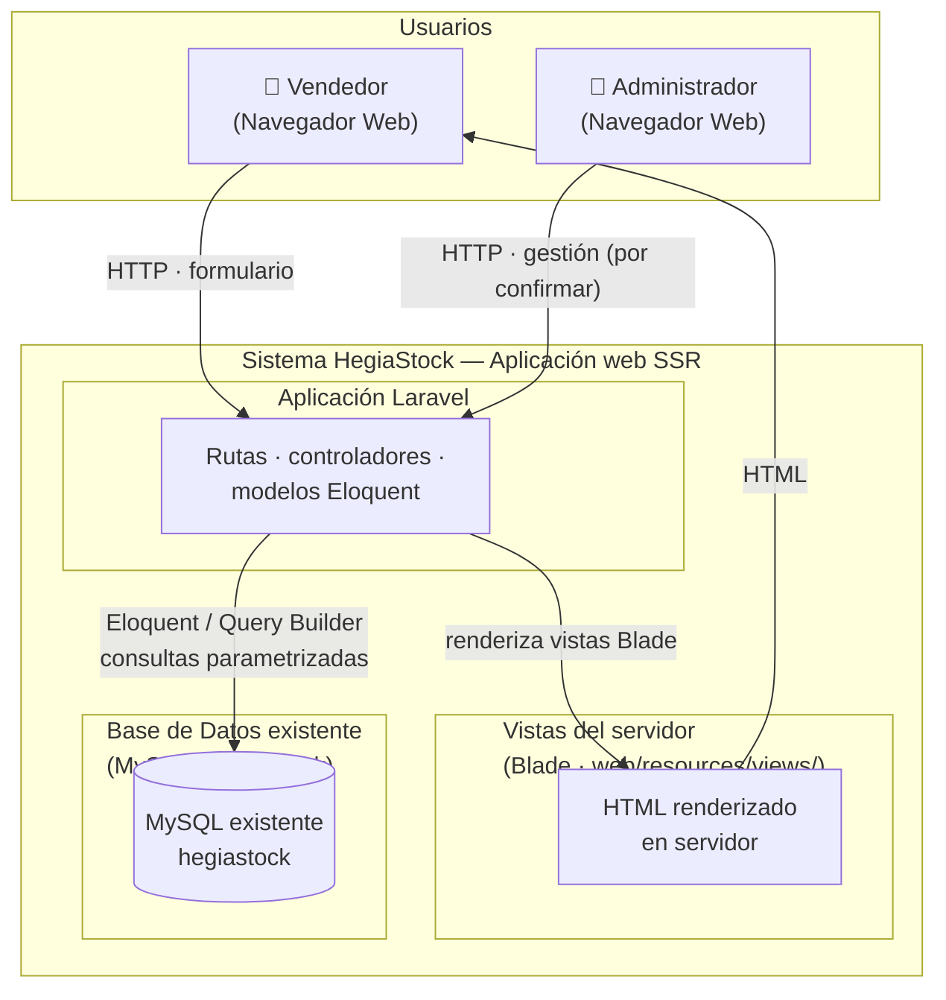
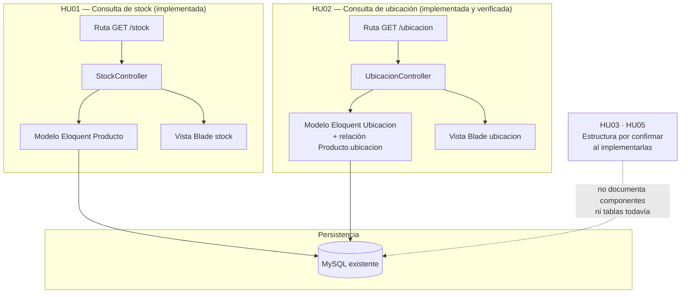
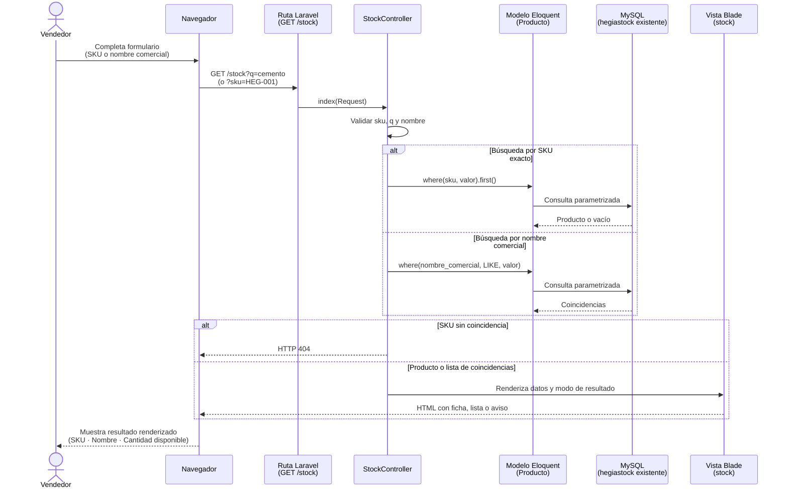
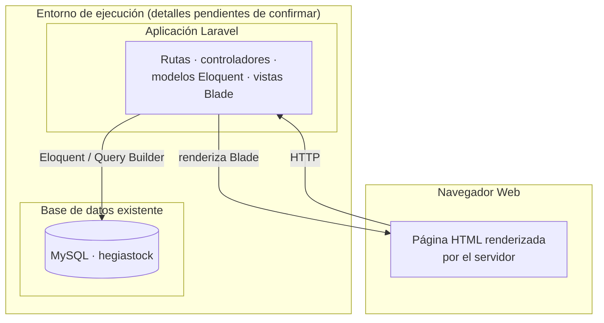

# Documento de Diseño — HegiaStock
**Versión:** 1.0 · **Fecha:** Octubre 2026 · **Estado:** Propuesto

---

## Overview

HegiaStock es una aplicación web para consultar inventario y registrar solicitudes de verificación. En la Sesión 7, la aplicación reside en `web/` y usa Laravel, vistas Blade, modelos Eloquent y la base MySQL existente `hegiastock`. La HU01 implementa una rebanada vertical SSR (ruta → controlador → modelo → vista) para consultar stock por SKU o nombre comercial. La estructura técnica de las demás historias debe confirmarse al implementarlas; no se deben inferir tablas ni componentes. No se crean migraciones ni seeders. No se almacenan datos personales de clientes (Ley N.° 29733). El punto de extensión conversacional queda reservado para la Unidad 3.

---

## Architecture

### 2.0 Diagrama C4 Nivel 1 — Contexto del Sistema

> **Nota:** Las conexiones punteadas a sistemas externos son puntos de extensión reservados para la Unidad 3. La cantidad exacta de productos y la forma de poblar/actualizar el catálogo existente quedan pendientes de confirmar; esta aplicación no debe crear migraciones ni seeders.

### 2.1 Diagrama C4 Nivel 2 — Contenedores

### 2.2 Diagrama C4 Nivel 3 — Componentes de la Aplicación

---

## 3. Diagrama de Secuencia — HU01: Consulta de Stock por SKU o Nombre Comercial

---

## 4. Diagrama de Despliegue

---

## Components and Interfaces

### Componentes comprobados y pendientes

| Componente | Responsabilidad / estado | Ubicación | Historia |
|---|---|---|---|
| Ruta `GET /stock` | Entrada de HU01 | `web/routes/web.php` | HU01 |
| `StockController` | Valida los parámetros, consulta el producto y selecciona la vista de respuesta | `web/app/Http/Controllers/StockController.php` | HU01 |
| Modelo `Producto` | Modelo Eloquent sobre la tabla existente `producto`; mantiene relaciones con categoría y unidad de medida | `web/app/Models/Producto.php` | HU01 |
| Modelos `Categoria`, `UnidadMedida` | Modelos Eloquent para las relaciones mostradas por HU01 | `web/app/Models/Categoria.php`, `web/app/Models/UnidadMedida.php` | HU01 |
| Vista `stock` | Formulario y resultados SSR con Blade | `web/resources/views/stock.blade.php` | HU01 |
| Ruta `GET /ubicacion` | Entrada de HU02 | `web/routes/web.php` | HU02 |
| `UbicacionController` | Valida SKU o nombre comercial, busca coincidencias, permite seleccionar producto y presenta la ubicación o el aviso correspondiente | `web/app/Http/Controllers/UbicacionController.php` | HU02 |
| Modelo `Ubicacion` y relación `Producto.ubicacion()` | Modelos Eloquent y relación con los campos de ubicación definidos por el modelo actual | `web/app/Models/Ubicacion.php`, `web/app/Models/Producto.php` | HU02 |
| Vista `ubicacion` | Formulario y resultados SSR con Blade, lista de coincidencias y selección por SKU | `web/resources/views/ubicacion.blade.php` | HU02 |
| HU03, HU05 y controles transversales | Componentes, ubicaciones de archivo, relaciones y estructura técnica pendientes de confirmar durante su implementación | Pendiente | HU03, HU05, HU07, HU09 |

> La HU01 observada usa una consulta vertical directa ruta → controlador → modelo → vista. No se documentan como existentes capas independientes de servicio o repositorio. No se deben inferir tablas ni componentes para historias aún no implementadas.

---

## Data Models

### Modelo de Datos

El modelo de datos de referencia (diagrama ER, trazabilidad y análisis de protección de datos) se encuentra en:

**[`docs/arquitectura/modelo_datos.md`](../../docs/arquitectura/modelo_datos.md)**

La aplicación de la Sesión 7 utiliza la base MySQL existente `hegiastock`; no se deben crear migraciones ni seeders. La correspondencia completa entre el modelo de referencia y el esquema real de esa base queda pendiente de confirmar. Para HU01 se han comprobado los modelos Eloquent `Producto`, `Categoria` y `UnidadMedida`. En HU02, los modelos actuales declaran `Ubicacion` sobre la tabla `ubicacion`, con clave primaria `id_ubicacion` y relación `belongsTo` por `id_producto`; `Producto` declara la relación `hasOne` correspondiente. El modelo `Ubicacion` incluye `numero_pasillo` y `codigo_estante`. Esto documenta el código y no verifica el esquema vivo de MySQL.

---

## 5.2 Interfaces y Contratos de Endpoints

Los contratos de HU01 y HU02 descritos abajo corresponden a la implementación revisada. La evidencia de HU02 es reportada por el equipo; no se afirma que las verificaciones manuales se hayan ejecutado durante esta actualización.

| Método | Ruta | Parámetros comprobados | Respuesta observada/documentada | Estado |
|---|---|---|---|---|
| `GET` | `/stock` | `sku` (SKU exacto); `q` (búsqueda por nombre); `nombre` (alias de `q`). Cadenas con límites validados por el controlador. | Sin parámetros: formulario; SKU encontrado: ficha; SKU inexistente: HTTP 404; búsqueda por nombre sin coincidencias: aviso; varias coincidencias: lista prevista en la vista. | Implementado. La lista para coincidencias múltiples existe en el código, pero no consta prueba manual reportada. |
| `GET` | `/ubicacion` | Sin parámetros: formulario. `sku` para consulta exacta; `q` para búsqueda parcial por nombre comercial y `nombre` como alias. Se validan como cadenas. | SKU/nombre encontrado: ubicación en formato exacto o aviso si no está registrada; nombre con varias coincidencias: lista de SKU y nombre para seleccionar; catálogo sin coincidencias: aviso y HTTP 404. | Implementado; pruebas manuales reportadas y pruebas Feature automatizadas ejecutadas. |
| — | HU03, HU05 | Pendientes de definir a partir de requisitos y esquema existente cuando se implementen. | Pendiente. | No presentarlos como endpoints implementados. |

Las vistas de HU01 y HU02 devuelven HTML renderizado con Blade. Las rutas y métodos HTTP indicados para las demás historias en el plan de tareas son planificación, no contratos verificados.

**Validación y persistencia de HU01:** el controlador usa la validación de Laravel; las consultas se hacen con Eloquent y valores enlazados/parametrizados. El nombre de la tabla `producto` está configurado en el modelo `Producto`. No se usa SQL concatenado con la entrada del usuario ni `DB::raw` para construir estas consultas.

**HU02:** la búsqueda exacta por SKU y la búsqueda parcial por nombre comercial usan Eloquent; los valores de búsqueda se pasan mediante parámetros enlazados por el Query Builder de Laravel. La validación acepta los parámetros opcionales `sku`, `q` y `nombre` como cadenas. Las coincidencias múltiples muestran SKU y nombre comercial y requieren una selección mediante una nueva consulta a la misma ruta con el SKU; este flujo está implementado, pero no hay evidencia de una prueba manual de coincidencias múltiples. Si el catálogo no encuentra el producto, la vista presenta el aviso con HTTP 404; si el producto existe pero carece de ubicación, se presenta el aviso de ubicación no registrada. Cuando hay ubicación, se presenta «Pasillo {numero_pasillo}, Estante {codigo_estante}». Las pruebas automatizadas Feature reportaron 4 tests y 34 assertions exitosas en conjunto para HU01 y HU02, incluyendo SKU existente y SKU inexistente. Las pruebas automatizadas de HU02 cubren la consulta por SKU, no la búsqueda por nombre, el caso sin ubicación ni las coincidencias múltiples.

**Punto de extensión Unidad 3:** se reserva la futura integración conversacional, pero ruta, método, payload y cambios requeridos quedan pendientes de diseño. No se asume un endpoint `POST /consulta` ni una arquitectura concreta para integrarlo.

---

## 8. Decisiones No Tomadas

Las siguientes decisiones quedan diferidas al diseño detallado o a fases posteriores:

1. **Estrategia de autenticación y autorización.** No se define mecanismo de login, tokens JWT ni separación de roles (Vendedor / Almacenero / Administrador) a nivel de ruteador. Queda para el diseño detallado determinar si se usará autenticación básica HTTP, sesiones con cookie firmada u OAuth 2.0. Ver ADR-004.

2. **Gestión del esquema MySQL existente.** La Sesión 7 usa las tablas existentes y prohíbe crear migraciones o seeders. El mecanismo autorizado para cambios futuros al esquema, si fueran necesarios, queda pendiente; no se asume que esta aplicación los aplique.

3. **Auditoría y retención de logs.** Los requisitos de privacidad aplicables se conservan; esquema, destino, eventos y retención de auditoría quedan pendientes de confirmar.

4. **Concurrencia de escritura en MySQL.** El comportamiento transaccional y de concurrencia de las futuras operaciones que escriban datos queda pendiente de diseño y verificación. No se adopta `BEGIN IMMEDIATE`, que corresponde a la documentación previa de SQLite.

5. **Formato y destino de logs.** No se ha confirmado qué eventos se registran, con qué granularidad ni si los logs se exportan a un sistema externo.

6. **Configuración de CORS y cabeceras de seguridad HTTP.** No se ha confirmado la política de `Content-Security-Policy` ni otras cabeceras de seguridad de Laravel.

7. **Estrategia de despliegue en cuenta gratuita (Semanas 7–8).** ADR-001 menciona un entorno de despliegue gratuito, pero no se ha seleccionado plataforma ni se han definido variables de entorno para ese entorno.

8. **Internacionalización y zona horaria en la interfaz.** La zona horaria aplicable a tickets y su presentación quedan pendientes de confirmar al implementar HU05.

9. **Módulo de Usuarios / Autenticación en Unidad 2.** La necesidad y el alcance de autenticación, así como su eventual relación con tablas existentes, deben confirmarse antes de diseñarse. No se da por comprobada ninguna tabla, ruta ni servicio de autenticación.

---

## Correctness Properties

Las siguientes son propiedades requeridas por el proyecto. Su inclusión no afirma que hayan sido verificadas o implementadas en todas las historias:

1. **Sin datos personales de clientes (Ley N.° 29733):** las funcionalidades deben evitar solicitar, persistir o exponer datos personales de clientes. El alcance de auditoría de logs y la implementación de controles transversales quedan pendientes de confirmar.
2. **Tickets:** cuando se implemente HU05, debe respetarse el identificador correlativo `VER-NNN`, su unicidad, estado inicial y metadatos definidos en `requirements.md`. Tablas, restricciones y estrategia de concurrencia deben verificarse contra el esquema existente antes de implementar; no se asumen aquí.
3. **Lectura del catálogo:** HU01 consulta el catálogo mediante Eloquent y solo tiene una ruta `GET /stock` en el alcance revisado. El comportamiento de lectura de otras historias debe comprobarse en su implementación.
4. **Stock y categorías:** HU03 debe filtrar y ordenar los productos según los criterios funcionales de `requirements.md`; las columnas, restricciones físicas y tablas correspondientes quedan pendientes de confirmar contra MySQL.
5. **Rendimiento:** se conservan los umbrales establecidos en `requirements.md`; no se afirma que se hayan medido.

---

## Error Handling

Comportamientos comprobados/documentados para HU01:

| Situación | Comportamiento | Estado |
|---|---|---|
| Sin parámetros de búsqueda | Se muestra el formulario de consulta. | Incluido en el controlador; prueba manual reportada. |
| SKU encontrado | Se muestra la ficha del producto. | Prueba manual reportada para `HEG-001`. |
| SKU inexistente | Se responde con HTTP 404 mediante `abort(404)`. | Prueba manual reportada para `INEXISTENTE`. |
| Nombre sin resultados | La vista presenta un aviso de producto no encontrado. | Implementado; prueba de nombre sin resultados pendiente. |
| Coincidencias múltiples por nombre | La vista presenta una lista de selección. | Implementado en código; prueba manual no reportada. |
| Error de base de datos u otras excepciones | Tratamiento específico de la aplicación por confirmar. | Pendiente. |

Para HU03 y HU05, los errores funcionales se deben definir conforme a `requirements.md` y verificarse al implementar esas historias. No se prescriben aquí respuestas de framework, páginas genéricas ni registros de auditoría no comprobados.

Verificaciones reportadas para HU02:

| Situación | Comportamiento / evidencia |
|---|---|
| Búsqueda por SKU de producto existente | Prueba manual reportada; automatizada con HTTP 200 y datos reales. |
| Búsqueda por nombre | Prueba manual reportada; no está cubierta por las pruebas automatizadas ejecutadas. |
| SKU inexistente | Prueba manual reportada; automatizada con HTTP 404. |
| Producto encontrado sin ubicación | Prueba manual reportada; no está cubierta por las pruebas automatizadas ejecutadas. |
| Producto con ubicación | Prueba manual y automatizada reportadas; respuesta con formato exacto «Pasillo {N}, Estante {código}». |
| Coincidencias múltiples por nombre | Implementado en código; no consta evidencia de prueba manual ni automatizada. |

---

## Testing Strategy

### Evidencia manual reportada para HU01

- `/stock` → formulario visible.
- `/stock?sku=HEG-001` → producto encontrado.
- `/stock?sku=INEXISTENTE` → HTTP 404.
- `/stock?q=cemento` → búsqueda por nombre funcional.

Esta evidencia fue reportada por el equipo; no significa que se hayan ejecutado pruebas durante la actualización de este documento. No se reportan mediciones de tiempo ni una prueba de coincidencias múltiples.

### Evidencia reportada para HU02

- Búsqueda por SKU: producto encontrado.
- Búsqueda por nombre: búsqueda funcional.
- Producto inexistente: comportamiento 404.
- Producto sin ubicación: aviso de ubicación no registrada.
- Las pruebas Feature automatizadas de HU01 y HU02 se ejecutaron conjuntamente: 4 tests y 34 assertions pasaron. Para HU02 comprueban producto existente por SKU con datos reales y SKU inexistente.
- No se reporta prueba manual ni automatizada de coincidencias múltiples.

### Verificaciones pendientes

- Probar HU01 cuando el nombre no tenga coincidencias y cuando produzca múltiples coincidencias.
- Probar HU02 con múltiples coincidencias por nombre y automatizar los flujos de búsqueda por nombre, producto sin ubicación y selección de coincidencia.
- Medir y registrar el tiempo de respuesta requerido por HU01/HU09.
- Definir pruebas de HU03, HU05 y controles transversales junto con la implementación de cada historia.
- Las integraciones de MCP, RAG y Gemini permanecen diferidas a Unidad 3.

---

## Historial de cambios

| Fecha | Hallazgo auditoría | Cambio realizado |
|---|---|---|
| 2026-10-02 | C1 — Faltaba C4 Nivel 1 | Agregada sección 2.0 con diagrama de Contexto del Sistema en Mermaid |
| 2026-10-02 | C2 — Faltaba sección de interfaces/contratos | Agregada sección 5.2 con tabla de endpoints y contratos Pydantic |
| 2026-10-02 | C3 — Modelo de datos sin enlace formal | Agregada sección 5.1 con referencias a `modelo_datos.md` y `schema.sql` |
| 2026-10-02 | C4 — Vestigios conversacionales en sección 7 | Eliminados ítems sobre `session_id`, `ChatRequest`, orquestador y ChromaDB; sección renumerada como 8 |
| 2026-10-02 | C10 — Cifra "~280 productos" sin fuente | Reemplazada por marca PENDIENTE con instrucción de verificación |
| 2026-10-02 | C12 — `RepositorioUsuarios` en modelo sin componente en design | Agregada nota explicativa al pie de la tabla de componentes |
| 2026-10-02 | Validador Kiro — 7 secciones faltantes | Renombradas secciones al inglés requerido (Overview, Architecture, Components and Interfaces, Data Models); agregadas secciones Correctness Properties, Error Handling y Testing Strategy |
| 2026-10-10 | Adaptación de diseño a Sesión 7 | Actualizadas las secciones de arquitectura, persistencia, contratos, errores y pruebas para reflejar Laravel, Blade, Eloquent y MySQL existente; los detalles aún no comprobados quedan pendientes. |
| 2026-10-11 | Verificación HU02 | Actualizados los estados de verificación con los resultados manuales y automatizados reportados; se mantiene pendiente probar coincidencias múltiples. |
