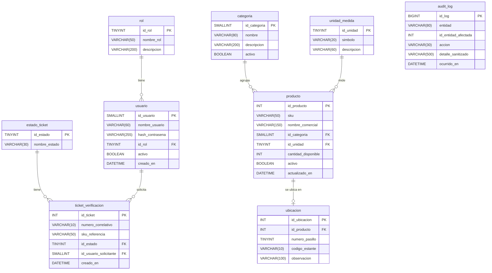

# Modelo de Datos — HegiaStock
**Versión:** 1.0 · **Fecha:** Octubre 2026 · **Estado:** Propuesto  
**Componente propietario:** `RepositorioStock`, `RepositorioUbicacion`, `RepositorioCategoria`, `RepositorioTickets`, `Modelos ORM` (`backend/core/database.py`)

> **Restricción transversal (Ley N.° 29733):** Ninguna tabla almacena datos personales de clientes finales (DNI, nombre completo, teléfono, dirección, datos de pago). Los usuarios registrados son exclusivamente personal interno operativo del sistema (Vendedor, Almacenero, Administrador).

---

## 1. Diagrama Entidad-Relación

---

## 2. Tabla de Trazabilidad

| Entidad | Componente propietario | Historia(s) |
|---|---|---|
| `rol` | `RepositorioUsuarios` / `Modelos ORM` | HU07 — separación de roles para no exponer datos de clientes; HU08 — control de acceso |
| `usuario` | `RepositorioUsuarios` / `Modelos ORM` | HU05 — el Vendedor que solicita la verificación queda registrado; HU07 — solo personal interno, sin PDP de clientes |
| `categoria` | `RepositorioCategoria` / `ServicioCategoria` | HU03 — filtrar y listar productos por categoría |
| `unidad_medida` | `RepositorioStock` / `ServicioStock` | HU01 — mostrar cantidad con unidad (kg, und, m); HU03 — idem en listado por categoría |
| `producto` | `RepositorioStock` / `ServicioStock` | HU01 — consulta de stock por SKU o nombre; HU02 — punto de partida para ubicación; HU03 — listado por categoría |
| `ubicacion` | `RepositorioUbicacion` / `ServicioUbicacion` | HU02 — consultar pasillo y estante exactos del producto |
| `estado_ticket` | `RepositorioTickets` / `ServicioTickets` | HU05 — catálogo de estados (Pendiente, En Verificación, Cerrado) |
| `ticket_verificacion` | `RepositorioTickets` / `ServicioTickets` | HU05 — registro formal VER-NNN con correlativo único, SKU y estado |
| `audit_log` | `FiltroPDP` / `Modelos ORM` | HU07 — registro de eventos sin datos personales; HU08 — trazabilidad de operaciones de solo lectura |

---

## 3. Script DDL

Ver archivo [`../../database/schema.sql`](../../database/schema.sql).

---

## 4. Protección de Datos — Ley N.° 29733

### 4.1 Análisis por columna

| Tabla | Columna | Clasificación | Medida adoptada |
|---|---|---|---|
| `usuario` | `nombre_usuario` | Dato operativo interno (alias de sistema, no nombre real) | Se almacena solo el identificador de sesión operativo (ej. `vendedor_01`), no nombre ni apellido real |
| `usuario` | `hash_contrasena` | Credencial de acceso | Almacenado exclusivamente como hash bcrypt; nunca en texto claro; excluido de `audit_log` |
| `ticket_verificacion` | `sku_referencia` | Dato de inventario (no personal) | Solo identifica el producto, no al cliente que lo consultó |
| `ticket_verificacion` | `id_usuario_solicitante` | Referencia interna al personal operativo | Identifica al Vendedor interno; no se almacena información del cliente final |
| `audit_log` | `detalle_sanitizado` | Texto libre de evento | Procesado por `FiltroPDP.sanitizar_para_log()` antes de persistir; cualquier patrón de PDP (DNI, teléfono, email, RUC, tarjeta) se reemplaza por `[DATO_PERSONAL]` |

### 4.2 Columnas ausentes por diseño

Las siguientes columnas están **explícitamente excluidas** de todo el esquema por mandato de la Ley N.° 29733:

- DNI / número de documento del cliente
- Nombre completo del cliente
- Teléfono del cliente
- Dirección del cliente
- Datos de tarjeta de pago
- Correo electrónico del cliente

### 4.3 Regla de verificación

Antes de cualquier `INSERT` en `ticket_verificacion` o `audit_log`, el componente `FiltroPDP` (`backend/core/pdp_filter.py`) valida que el conjunto de claves sea exactamente el declarado en el esquema. Un campo adicional inesperado detiene la operación con excepción `PDPViolationError`.
